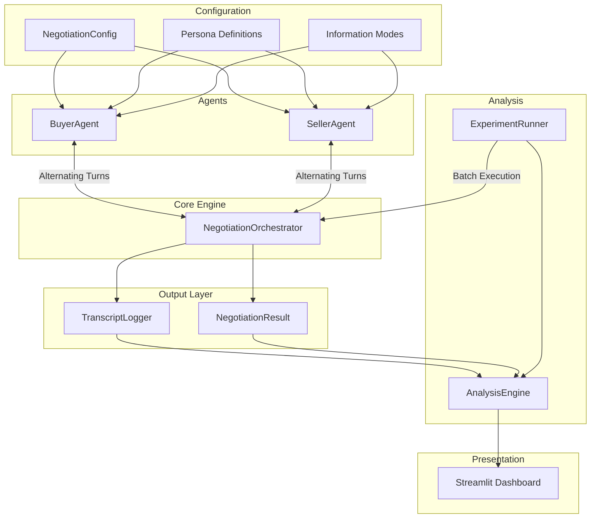
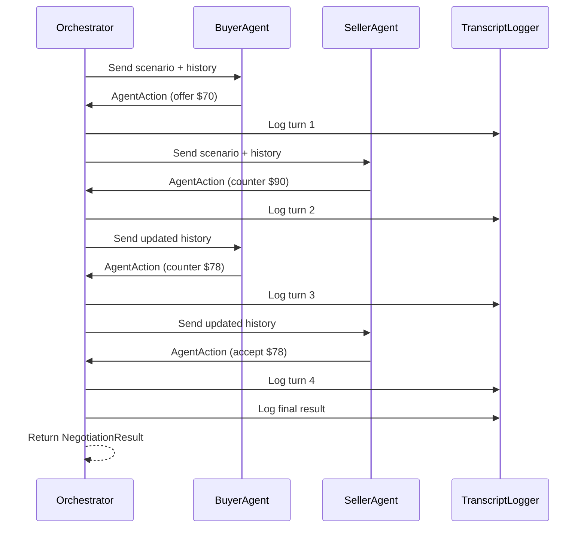
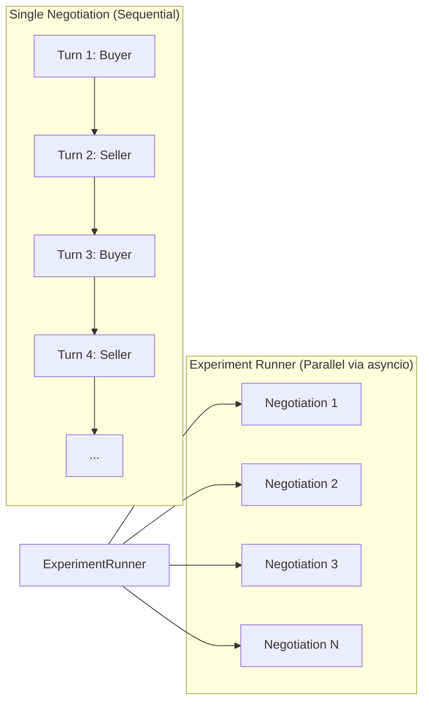

# Project Concord — System Architecture

> **Multi-Agent LLM Negotiation Simulation Framework**

---

## 1. High-Level Architecture



---

## 2. Component Descriptions

### 2.1 Configuration (`concord/config.py`)

| Element | Description |
|---|---|
| `NegotiationConfig` | Frozen dataclass holding all parameters for a single negotiation session — item name, buyer max price, seller min price, max turns, persona assignments, information mode, and model settings. |
| `PersonaType` | Enum: `COOPERATIVE`, `NEUTRAL`, `AGGRESSIVE`. Each maps to a distinct system prompt that shapes the agent's negotiation strategy. |
| `InfoMode` | Enum: `SYMMETRIC_HIDDEN`, `ASYMMETRIC_BUYER_KNOWS`, `ASYMMETRIC_SELLER_KNOWS`. Controls what reservation-price information is revealed to each agent. |

### 2.2 Agent Framework (`concord/agents/`)

| Component | Responsibility |
|---|---|
| `NegotiationAgent` (base) | Abstract base class. Constructs the LLM system prompt from persona + role + scenario context. Sends conversation history to the model and parses the structured JSON response into an `AgentAction` dataclass. |
| `BuyerAgent` | Extends base agent. Holds `max_budget`. Objective: minimize the agreed price. System prompt instructs the model to never exceed the budget. |
| `SellerAgent` | Extends base agent. Holds `min_cost`. Objective: maximize the agreed price. System prompt instructs the model to never accept below cost. |

**Structured Output Contract:**

Every LLM response is parsed into the following JSON schema:

```json
{
  "action": "offer | accept | reject | counter | walk_away",
  "offer": 75.00,
  "message": "Natural language message to the other party",
  "reasoning": "Internal chain-of-thought (hidden from opponent)"
}
```

### 2.3 Orchestrator Engine (`concord/orchestrator.py`)

The orchestrator is the central coordination point for a negotiation session.

**Responsibilities:**
- **Turn Management** — Alternates control between buyer and seller. The buyer always moves first.
- **Conversation History** — Maintains a shared message list visible to both agents (excluding private `reasoning` fields).
- **Termination Detection** — Checks after each turn whether the negotiation has ended:
  - *Agreement:* One party offers and the other accepts.
  - *Walk-Away:* A party issues a `walk_away` action.
  - *Max Turns:* The configured turn limit is reached without resolution.
- **Result Generation** — Produces a `NegotiationResult` containing the outcome, agreed price (if any), turn count, total duration, and per-agent surplus.



### 2.4 Transcript Logger (`concord/transcript_logger.py`)

| Feature | Detail |
|---|---|
| **Per-Turn Logging** | Each turn is recorded as a JSON object: turn number, role, persona, action, offer amount, natural-language message, private reasoning, ISO 8601 timestamp. |
| **Session Metadata** | Config snapshot, outcome, total duration, final price, surplus breakdown. |
| **Storage** | Files saved to `data/transcripts/{session_id}.json`. Session IDs include timestamp + config hash for uniqueness. |
| **Dual Format** | Machine-parseable JSON for analysis; optional human-readable Markdown export. |

### 2.5 Analysis Engine (`concord/analysis.py`)

Ingests transcript JSON files and computes quantitative metrics using **pandas**:

| Metric | Definition |
|---|---|
| Deal Success Rate | `(agreements / total_runs) × 100` |
| Rounds to Convergence | Mean turn count across successful deals |
| Surplus Split | `buyer_surplus / total_surplus` vs. `seller_surplus / total_surplus` |
| Pareto Efficiency | Whether the agreed price falls within the efficient frontier (full surplus captured) |
| Nash Bargaining Distance | Distance from the Nash bargaining solution `(max + min) / 2` |

Generates charts via **matplotlib** and **plotly**:
- Bar charts: success rate by persona combination
- Heatmaps: average price by buyer persona × seller persona
- Box plots: surplus distribution across conditions
- Line charts: convergence trends over turns

### 2.6 Experiment Runner (`concord/experiments.py`)

Executes the full experimental matrix:

```
3 buyer personas × 3 seller personas × 2 info modes = 18 conditions
× 20–30 trials per condition
= 360–540 total negotiation runs
```

**Features:**
- Batch execution with configurable concurrency
- Progress bar and ETA tracking
- Graceful failure handling with retry logic
- Partial result persistence (results saved incrementally)
- Summary DataFrame generation for downstream analysis

### 2.7 Streamlit Dashboard (`concord/ui/`)

| Page | Description |
|---|---|
| **Live Viewer** | Configure and run a negotiation in real time. Watch offers, counter-offers, and messages appear turn by turn. |
| **Transcript Browser** | Browse saved sessions. Filter by persona, outcome, info mode. Replay negotiations step by step. |
| **Analysis Dashboard** | Interactive charts from experiment results. Compare persona pairs, information modes, and metric distributions. |
| **Experiment Launcher** | Configure experimental matrix parameters and launch batch runs from the browser UI with live progress tracking. |

---

## 3. Data Flow — Single Negotiation Session

1. **Configuration** — A `NegotiationConfig` is instantiated with item details, reservation prices, persona types, information mode, and model parameters.
2. **Agent Initialization** — `BuyerAgent` and `SellerAgent` are created, each receiving their role-specific config and system prompt.
3. **Orchestration Loop** — The orchestrator alternates turns:
   - Sends the current conversation history to the active agent.
   - The agent calls the LLM, receives a structured JSON response, and returns an `AgentAction`.
   - The orchestrator logs the turn via `TranscriptLogger`.
   - The orchestrator checks termination conditions.
4. **Result Generation** — On termination, the orchestrator computes the `NegotiationResult` (outcome, final price, surplus split, turn count).
5. **Persistence** — The full transcript and result are saved to disk as JSON.
6. **Analysis** (optional) — The analysis engine can ingest the transcript for metric computation and chart generation.

---

## 4. Key Design Decisions

### 4.1 Structured JSON Output from LLMs

**Decision:** Require every LLM response to conform to a strict JSON schema rather than free-form text.

**Rationale:**
- Enables deterministic parsing of actions and offers.
- Separates the negotiation *action* (offer, accept, walk away) from the natural-language *message*.
- Captures private *reasoning* for post-hoc analysis without leaking strategy to the opponent.
- Makes automated metric computation reliable and robust.

### 4.2 Alternating Turn-Based Protocol

**Decision:** Buyer and seller alternate turns in strict sequence, starting with the buyer.

**Rationale:**
- Mirrors real-world negotiation structure (proposal → response).
- Simplifies conversation history management.
- Ensures fair and comparable turn counts across experiments.
- Avoids race conditions inherent in simultaneous-move models.

### 4.3 Dataclasses Over Dictionaries

**Decision:** Use Python `@dataclass` (with `frozen=True` where applicable) for all structured data.

**Rationale:**
- Type safety and IDE autocompletion.
- Immutable configs prevent accidental mutation during experiments.
- Clean serialization to/from JSON for logging and persistence.
- Self-documenting code with explicit field names and types.

### 4.4 Separation of Concerns

**Decision:** Keep the orchestrator stateless with respect to strategy; all decision-making lives in the agent prompts.

**Rationale:**
- The orchestrator is a pure coordinator — it does not influence negotiation strategy.
- This makes it easy to swap models, personas, or even agent architectures without modifying the core engine.

---

## 5. Technology Stack

| Layer | Technology | Purpose |
|---|---|---|
| Language | Python 3.11+ | Core runtime |
| LLM SDK | `google-genai` | Interface to Google Gemma 4 / Gemini models |
| Data Analysis | `pandas` | Metric computation and data manipulation |
| Visualization | `matplotlib`, `plotly` | Static and interactive charts |
| Dashboard | `streamlit` | Web-based UI for live viewing and analysis |
| Configuration | `python-dotenv` | Environment variable management (API keys) |
| Serialization | `dataclasses` + `json` | Structured data handling |
| CLI | `argparse` / `click` | Command-line entry point |
| Async | `asyncio` | Concurrent experiment execution |

---

## 6. Concurrency Model



**Within a single negotiation:** Turns are strictly sequential. Each turn waits for the LLM response before proceeding. This preserves the causal chain of offers and counter-offers.

**Across experiments:** Multiple independent negotiation sessions run concurrently via `asyncio`. A semaphore controls the maximum number of parallel API calls to respect rate limits. Results are collected and aggregated once all runs in a batch complete.

---

> **Document Version:** 1.0
> **Last Updated:** Phase 9 completion
