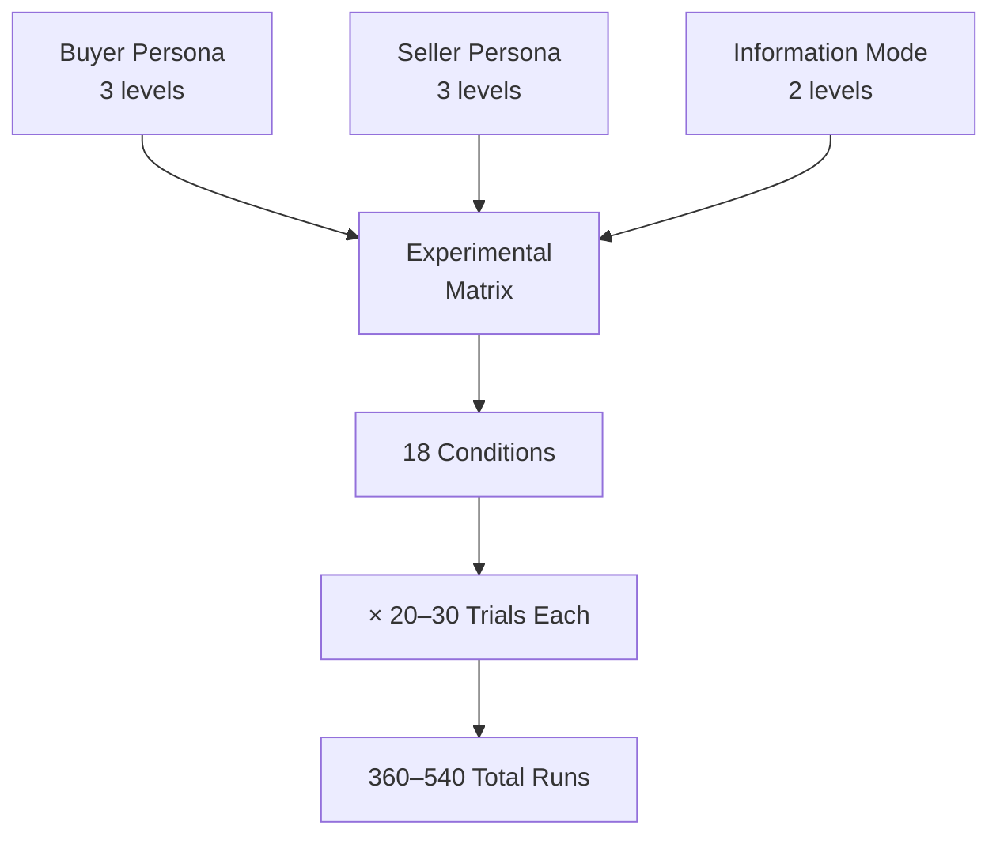

# Project Concord — Experiment Design

> **Multi-Agent LLM Negotiation Simulation Framework**

---

## 1. Research Objective

Investigate how **agent persona** (negotiation strategy) and **information asymmetry** affect the outcomes of LLM-driven bilateral negotiations, measuring deal success rates, convergence speed, surplus distribution, and economic efficiency.

---

## 2. Independent Variables

### 2.1 Agent Persona

Each agent (buyer and seller independently) is assigned one of three persona types that shape their negotiation strategy via distinct system prompts:

| Persona | Strategy Description | Key Behavioral Traits |
|---|---|---|
| **Cooperative** | Prioritizes mutual gain and relationship preservation. Seeks win-win outcomes. | Makes reasonable opening offers close to fair value. Willing to make meaningful concessions. Avoids aggressive anchoring. Frequently acknowledges the other party's needs. |
| **Neutral** | Balanced, rational negotiation with moderate assertiveness. | Opens near the midpoint of their acceptable range. Makes measured, reciprocal concessions. Uses standard negotiation tactics without extreme positioning. |
| **Aggressive** | Maximizes own surplus with minimal concessions. Hard-bargaining strategy. | Opens with extreme anchoring offers. Makes very small, reluctant concessions. Uses pressure tactics and deadlines. Willing to walk away to maintain leverage. |

### 2.2 Information Mode

Controls the information asymmetry between the negotiating parties regarding reservation prices (the buyer's maximum budget and the seller's minimum acceptable cost):

| Mode | Buyer Knows | Seller Knows | Description |
|---|---|---|---|
| **Symmetric Hidden** | Own max budget only | Own min cost only | Neither party knows the other's reservation price. This is the standard negotiation condition — each agent must infer the other's boundaries from behavior. |
| **Asymmetric Buyer Knows** | Own max budget + Seller's min cost | Own min cost only | The buyer has full information about the bargaining zone. This advantages the buyer, who can calibrate offers just above the seller's minimum. |
| **Asymmetric Seller Knows** | Own max budget only | Own min cost + Buyer's max budget | The seller has full information about the bargaining zone. This advantages the seller, who can push prices toward the buyer's maximum. |

> [!NOTE]
> In asymmetric modes, the informed party receives the other's reservation price in their system prompt. The uninformed party's prompt remains unchanged from the symmetric hidden condition.

---

## 3. Dependent Variables (Metrics)

### 3.1 Primary Metrics

| Metric | Formula | Interpretation |
|---|---|---|
| **Deal Success Rate** | $\frac{\text{Agreements}}{\text{Total Runs}} \times 100\%$ | Percentage of negotiations that end in a mutually accepted deal (vs. walk-away or timeout). Higher = more deals closed. |
| **Rounds to Convergence** | $\text{Mean}(\text{turns per successful deal})$ | Average number of turns required to reach agreement. Lower = faster convergence. Only computed for successful negotiations. |
| **Buyer Surplus %** | $\frac{\text{Buyer Max} - \text{Agreed Price}}{\text{Buyer Max} - \text{Seller Min}} \times 100\%$ | Percentage of the total available surplus captured by the buyer. |
| **Seller Surplus %** | $\frac{\text{Agreed Price} - \text{Seller Min}}{\text{Buyer Max} - \text{Seller Min}} \times 100\%$ | Percentage of the total available surplus captured by the seller. |

### 3.2 Efficiency Metrics

| Metric | Formula | Interpretation |
|---|---|---|
| **Pareto Efficiency** | Binary: Did the deal capture the full surplus zone? | A deal is Pareto efficient if no reallocation could make one party better off without making the other worse off. In our bilateral setting, any agreed price in `[Seller Min, Buyer Max]` is Pareto efficient. Failed negotiations are Pareto *inefficient* (surplus left on the table). |
| **Nash Bargaining Distance** | $\lvert \text{Agreed Price} - \frac{\text{Buyer Max} + \text{Seller Min}}{2} \rvert$ | Distance from the Nash bargaining solution (the midpoint of the bargaining zone). Measures fairness — lower distance = more symmetric outcome. |

### 3.3 Behavioral Metrics (Secondary)

| Metric | Description |
|---|---|
| **Opening Offer Aggressiveness** | How far the first offer is from the agent's own reservation price (as % of surplus zone). |
| **Concession Rate** | Average per-turn price movement (in the direction of agreement). |
| **Walk-Away Rate** | Percentage of negotiations terminated by a deliberate `walk_away` action. |
| **Timeout Rate** | Percentage of negotiations that hit the max turn limit. |

---

## 4. Experimental Matrix

### 4.1 Full Factorial Design

### 4.2 Condition Table

| # | Buyer Persona | Seller Persona | Information Mode | Trials |
|---|---|---|---|---|
| 1 | Cooperative | Cooperative | Symmetric Hidden | 20–30 |
| 2 | Cooperative | Neutral | Symmetric Hidden | 20–30 |
| 3 | Cooperative | Aggressive | Symmetric Hidden | 20–30 |
| 4 | Neutral | Cooperative | Symmetric Hidden | 20–30 |
| 5 | Neutral | Neutral | Symmetric Hidden | 20–30 |
| 6 | Neutral | Aggressive | Symmetric Hidden | 20–30 |
| 7 | Aggressive | Cooperative | Symmetric Hidden | 20–30 |
| 8 | Aggressive | Neutral | Symmetric Hidden | 20–30 |
| 9 | Aggressive | Aggressive | Symmetric Hidden | 20–30 |
| 10 | Cooperative | Cooperative | Asymmetric Buyer Knows | 20–30 |
| 11 | Cooperative | Neutral | Asymmetric Buyer Knows | 20–30 |
| 12 | Cooperative | Aggressive | Asymmetric Buyer Knows | 20–30 |
| 13 | Neutral | Cooperative | Asymmetric Buyer Knows | 20–30 |
| 14 | Neutral | Neutral | Asymmetric Buyer Knows | 20–30 |
| 15 | Neutral | Aggressive | Asymmetric Buyer Knows | 20–30 |
| 16 | Aggressive | Cooperative | Asymmetric Buyer Knows | 20–30 |
| 17 | Aggressive | Neutral | Asymmetric Buyer Knows | 20–30 |
| 18 | Aggressive | Aggressive | Asymmetric Buyer Knows | 20–30 |

> [!NOTE]
> The table above shows conditions for Symmetric Hidden and Asymmetric Buyer Knows. The same 9 persona combinations also apply to Asymmetric Seller Knows, yielding a 3 × 3 × 3 = 27 condition matrix if all three asymmetric modes are tested. The core design uses 2 information modes (18 conditions) but can be extended to 3 modes (27 conditions).

### 4.3 Sample Size Justification

- **20–30 trials per condition** provides sufficient statistical power for detecting medium-to-large effect sizes (Cohen's d ≥ 0.5) at α = 0.05 with power ≥ 0.80.
- LLM outputs are stochastic (temperature > 0), so multiple trials capture the variance in agent behavior.
- Total runs: **360–540 negotiations** across the full matrix.

---

## 5. Default Scenario Parameters

All experiments use a standardized negotiation scenario to ensure comparability:

| Parameter | Value |
|---|---|
| **Item** | Vintage Mechanical Keyboard |
| **Buyer's Maximum Budget** | \$100 |
| **Seller's Minimum Cost** | \$60 |
| **Surplus Zone (ZOPA)** | \$40 (range: \$60 – \$100) |
| **Nash Bargaining Solution** | \$80 (midpoint) |
| **Maximum Turns per Session** | 20 |
| **LLM Temperature** | 0.7 (default; balances creativity and consistency) |

> [!IMPORTANT]
> The surplus zone of \$40 provides ample room for negotiation dynamics. Both agents have clear incentives: the buyer wants to pay as little above \$60 as possible, and the seller wants to charge as close to \$100 as possible.

---

## 6. Statistical Analysis Plan

### 6.1 Descriptive Statistics

For each experimental condition, compute:
- **Mean** and **standard deviation** for all continuous metrics (agreed price, rounds to convergence, surplus split)
- **Frequency counts** for categorical outcomes (deal success, walk-away, timeout)

### 6.2 Comparative Tests

| Comparison | Test | Purpose |
|---|---|---|
| Persona effect on success rate | Chi-squared test / Fisher's exact test | Test whether persona assignment significantly affects deal success rates |
| Persona effect on agreed price | Independent samples t-test / Welch's t-test | Compare mean agreed prices across persona pairs |
| Information mode effect | Mann-Whitney U test | Compare outcome distributions between symmetric and asymmetric conditions |
| Multi-factor effects | Two-way ANOVA | Test interaction effects between buyer persona and seller persona on surplus split |

### 6.3 Effect Size Measures

- **Cohen's d** for pairwise comparisons of continuous variables
- **Cramér's V** for categorical outcome comparisons
- Report 95% confidence intervals for all point estimates

### 6.4 Visualization Plan

| Chart Type | Variables | Purpose |
|---|---|---|
| **Grouped Bar Chart** | Deal success rate by persona pair | Compare outcomes across all 9 persona combinations |
| **Heatmap** | Mean agreed price (Buyer Persona × Seller Persona) | Visualize price patterns across the full matrix |
| **Box Plot** | Surplus split distribution by condition | Show variability in surplus allocation |
| **Line Chart** | Offer trajectory over turns (averaged) | Visualize convergence patterns |
| **Stacked Bar Chart** | Outcome breakdown (agree / walk-away / timeout) by condition | Compare termination types |
| **Violin Plot** | Rounds to convergence by persona | Show distribution shape and density |
| **Scatter Plot** | Nash distance vs. rounds | Explore relationship between fairness and speed |

### 6.5 Hypotheses

| # | Hypothesis | Expected Direction |
|---|---|---|
| H1 | Cooperative–Cooperative pairs will have the highest deal success rate | Cooperative > Neutral > Aggressive |
| H2 | Aggressive–Aggressive pairs will have the highest walk-away rate | More mutual aggressive posturing → more deadlocks |
| H3 | Information asymmetry will shift surplus toward the informed party | Buyer-knows → lower prices; Seller-knows → higher prices |
| H4 | Cooperative agents will converge faster (fewer rounds) | Willingness to concede accelerates agreement |
| H5 | Neutral–Neutral pairs will produce prices closest to the Nash solution | Balanced strategy → fairest outcome |

---

## 7. Execution Protocol

1. **Randomization** — Trial order within each condition is randomized to mitigate ordering effects.
2. **Seed Logging** — Random seeds and timestamps are logged for reproducibility.
3. **Failure Handling** — API errors or malformed responses trigger automatic retry (up to 3 attempts). Persistent failures are logged and excluded from analysis.
4. **Incremental Persistence** — Results are saved after each trial, ensuring no data loss on interruption.
5. **Progress Tracking** — Real-time progress display with completion estimates.

---

> **Document Version:** 1.0
> **Last Updated:** Phase 9 completion
